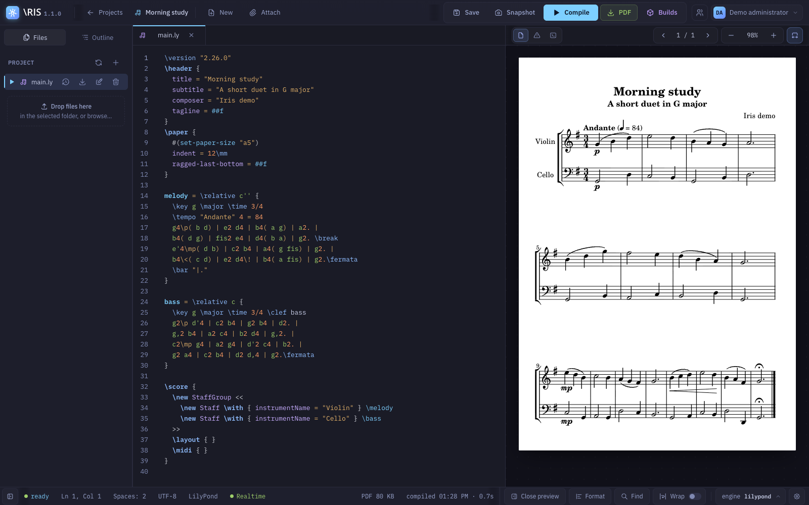
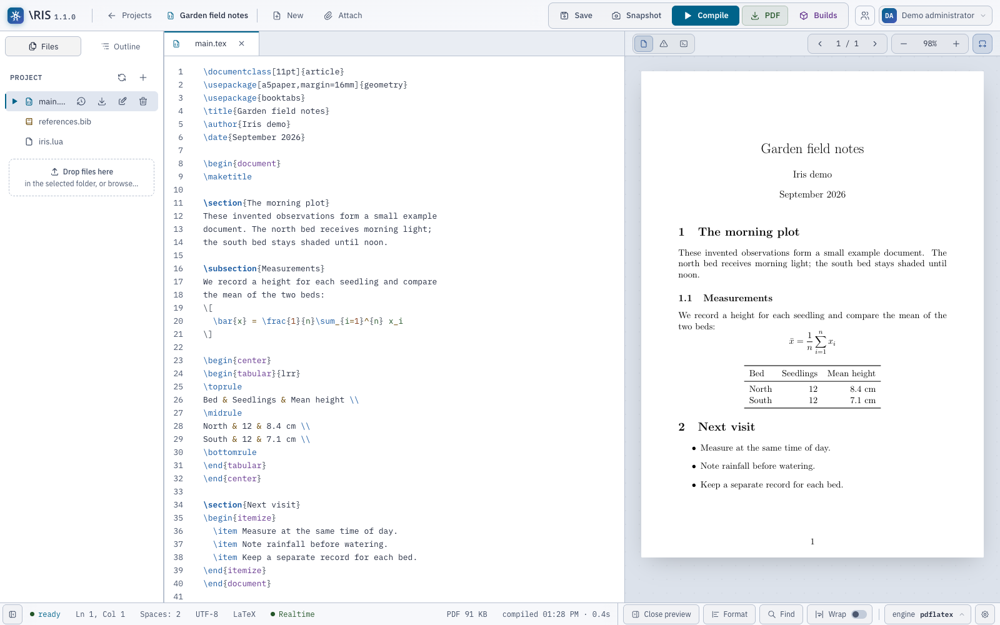

<h1 align="center">
  
   
  <picture>
    <source media="(prefers-color-scheme: dark)" srcset="branding/iris_text_logo_w.svg">
    
  </picture>
</h1>

Iris is a self-hosted web editor for **LaTeX documents and LilyPond scores**.
Write source, manage files and fonts, compile on your server, and read the
result beside your code. Share projects and edit together in the browser.

[Install Iris](docs/installation.md) · [User guide](docs/user-guide.md) ·
[Lua plugins](docs/lua-pipelines.md) · [All documentation](docs/README.md)

## Get started

To run an instance, install **Node.js 24+**, **PostgreSQL 18+** and the LaTeX
and/or LilyPond tools you need. Install **Lua 5.4 or 5.5** to run project plugins.
Follow [native installation](docs/installation.md#native-installation), or
[build the container image](docs/installation.md#local-container-build) with
Docker or Podman. The container includes Lua; add TeX or LilyPond inside its
runtime for document or score compilation.

To use an existing instance:

1. Sign in with the account your administrator provides.
2. Create a LaTeX or LilyPond project and choose a template.
3. Edit `main.tex` or `main.ly`. Use **Settings → Compilation** to choose the
   main file, compiler workflow or output format.
4. Press **Compile** and read the preview. Open **Builds** for diagnostics and
   downloads.

Use **Save** for project changes and **Snapshot** to record a recovery point.
The [user guide](docs/user-guide.md) explains editing, compilation and sharing.

## Edit documents and scores

- Syntax highlighting, outline, completion, search, replacement and indentation.
- Project folders, attachments, included sources and uploaded fonts.
- BibTeX, BibLaTeX and RIS reference tables with source-preserving forms.
- English and Italian interfaces, with light, dark and system themes.

## Compile and inspect output

Use pdfLaTeX, XeLaTeX or LuaLaTeX with bibliography and index workflows.
LilyPond produces PDF, PNG, SVG, PS or EPS, plus MIDI when requested by the score.
Preview PDFs and images, inspect compiler diagnostics and download build files.

Ctrl-click or Cmd-click moves between a PDF and its source. See
[PDF/source navigation](docs/user-guide.md#move-between-pdf-and-source) for the
controls and required tools.

Project-local [Lua plugins](docs/lua-pipelines.md) can generate source, inspect
compiled layout, compose PDFs and run explicit multi-pass workflows. Configure
their parameters and targets under **Settings → Compilation → Lua pipeline**.

## Collaborate and recover work

Share a project with owners, editors or viewers. Live editing shows collaborators'
cursors and selections, with presence in the file tree and outline. Inspect file
revisions, restore earlier text and select retained compilation results.

Export a project as a ZIP or import it into another Iris instance. Full instance
backups include both PostgreSQL and filesystem storage; use the
[backup and restore procedure](docs/administration.md#backup-and-restore).

## Run and maintain an instance

Iris uses one Node.js process per database/storage installation. Current source
and assets live in the filesystem; PostgreSQL stores accounts, permissions,
revision history, build records and audit entries. Native tools compile separate
source snapshots so editing can continue during a build.

| Task | Guide |
| --- | --- |
| Install or start Iris | [Installation](docs/installation.md) |
| Configure environment variables | [Configuration](docs/configuration.md) |
| Manage accounts, SSO and projects | [Administration](docs/administration.md) |
| Upgrade an installation | [Upgrade Iris](docs/administration.md#upgrade-iris) |
| Work on the code and run tests | [Development](docs/development.md) |
| Add a translation | [Translating Iris](TRANSLATING.md) |
| Manage project templates | [Template reference](public/templates/README.md) |

For a bug report, include the Iris version or source revision, browser, deployment
type, reproduction steps and a small source example.

## License

Iris uses **GPL-3.0-or-later**. See [LICENSE](LICENSE) and
[third-party notices](THIRD_PARTY_NOTICES.md). Screenshots use
[synthetic demonstration projects](docs/images/README.md).

