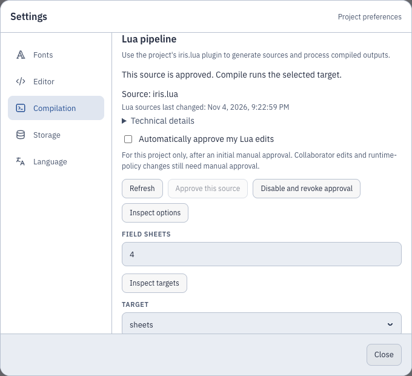
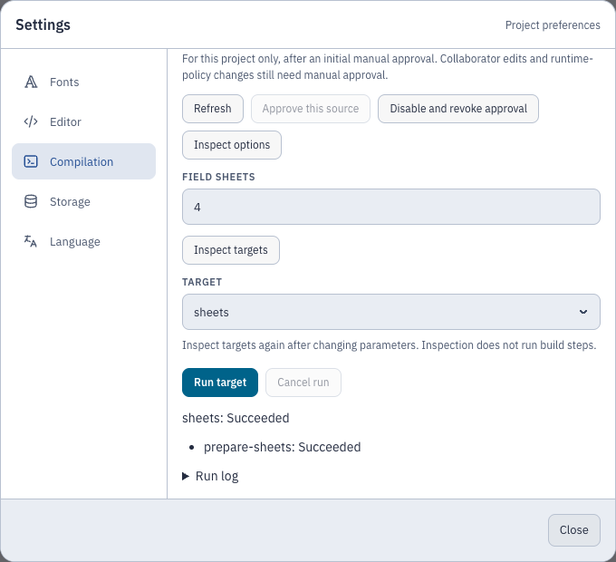

# Lua pipelines

Use a project-local Lua plugin to generate sources, inspect compiled output and
run a custom build workflow. Install Lua 5.4 or 5.5 on the server; see
[installation](installation.md#native-installation) and
[runtime settings](configuration.md#lua-pipeline-runtime-limits).

- [Approve, inspect and run](#approve-inspect-and-run)
- [Write a plugin](#plugin-and-graph-api-version-1)
- [Source-generation example](#minimal-source-generation-example)
- [Parameters](#parameters-and-lua-values) and [transform callbacks](#transform-callbacks)
- [Compiler and composition adapters](#compiler-and-composition-adapters)
- [Storage and recovery](#storage-and-recovery)

A project can use `iris.lua` to generate sources, compile LaTeX or standalone
LilyPond, inspect the compiled layout, and compose PDFs. A plugin returns a static
dependency graph with named targets. A target can publish several files or only
validate inputs. Explicit repeated compiler steps support multi-pass workflows;
the engine does not expand the graph or iterate until convergence.

## Approve, inspect and run

1. Add `iris.lua` and any Lua modules to the project, then save.
2. Open **Settings → Compilation → Lua pipeline**.
3. As a project owner, choose **Approve this source**.
   Approval binds all project Lua files, the adapter implementations and the execution policy.
   Changes to those identities require approval again.
4. Choose **Inspect options** to execute the module and read its parameter schema.
5. Set parameters and choose **Inspect targets**. This invokes the planner on an
   authoritative source snapshot without running graph steps. Reinspect after
   changing parameters.
6. Select a target and choose **Run target**, or close settings and use **Compile**.
   With the pipeline enabled, Compile runs the selected target. Iris saves through
   its ordinary project mutation queue before submitting the run.



The source summary shows **Source: iris.lua** and **Lua sources last changed** in your local date and time format.
The time covers edits, additions, renames and removals across all project Lua files, including live collaborative edits.
Saving unchanged source preserves the time.
**Not recorded** means Iris has no reliable edit time, including legacy projects and changes made outside Iris.
Expand **Technical details** to see the source bundle hash.

Owners can select **Automatically approve my Lua edits** for their own account in this project.
After the first manual approval, Iris can approve changes attributable only to that owner when saving, refreshing the controls or choosing Compile.
Edits by collaborators, mixed or unknown authorship, and changed runtime policy or adapter identities require manual approval.
Disabling or revoking the pipeline also requires a manual approval before automatic approval can resume.
If Iris restarts before it persists approved live edits, review the surviving source and approve it manually.
The preference grants no additional permissions and does not transfer with project ZIPs.
Inspect options and targets again after source changes before running the revised plugin.

Opening a project or reading pipeline metadata does not execute Lua. Inspection
does execute module-level code, so approval precedes inspection. Run admission
replans against its own snapshot and checks the descriptor identity again.
Compile refreshes enablement before choosing a workflow. If another owner enables
the pipeline during that request, the server rejects ordinary compilation and
asks the client to select a pipeline target.

Owners and editors can inspect and run approved code. Editors can cancel their
own runs; owners can cancel any project run. Viewers can read retained runs and
download their artifacts. **Disable and revoke approval** cancels affected work
and returns Compile to the ordinary compiler workflow. Revocation preserves
sources and retained outputs.

The controls show step states, diagnostics and the bounded run log. Failed or
cancelled runs retain the successful preview. Target selection loads that target's
latest successful result by accepted request order, not completion time. A target
without preview output has no preview to select. Reconnecting resynchronizes
server state and preserves a preview you selected manually from Builds.



## Plugin and graph API, version 1

`iris.lua` returns a table containing `apiVersion=1`, a `pluginId`, a `plan(ctx)`
function, and optionally `parameterSchema` and `requiredCapabilities`. The planner
returns the same metadata plus `steps` and `targets`. It must not change the
inspected descriptor or normalized parameter values.

The planner receives `ctx.parameters`, `ctx.capabilities` and `ctx.snapshot`.
The snapshot describes files, directories, project settings and its hash. Planning
has no transform I/O callbacks. Use a transform step to read file contents.

Each step has a unique `id`, an exact adapter `{id, version}`, named `inputs`,
adapter `options`, and named `outputs`. Inputs refer to `{snapshot=true}` or a
previous output using `{step="producer", port="output"}`. Dependencies come from
these references; array order alone does not order execution.

An output declares `kind`, `mediaType` and `path`. Kinds are `file`, `collection`
and, for compiler layout, `layout`. Paths are relative logical paths without
parent traversal, absolute prefixes or backslashes. Collections have bounded
membership and cannot add graph steps at runtime.

A target declares terminal `steps`, a `publish` array of output references, and
an optional `primaryPreview` reference. A primary reference must resolve to one
PDF or supported raster artifact. Iris rejects missing, ambiguous and unsafe
primary selections before publication. For a validation-only target, use
`publish=iris.array{}`.

### Minimal source-generation example

Save this as `iris.lua`. It publishes a generated LilyPond source without invoking
a compiler. Download `generated.ly` from Builds.

```lua
local schema = {
  type = "object",
  properties = { count = { type = "integer", minimum = 1, maximum = 16, default = 4 } }
}
return {
  apiVersion = 1,
  pluginId = "generated-score",
  parameterSchema = schema,
  plan = function(ctx)
    return {
      apiVersion = 1,
      pluginId = "generated-score",
      parameterSchema = schema,
      steps = {
        {
          id = "generate",
          adapter = { id = "iris.lua", version = "1.0.0" },
          options = { script = "iris.lua", entrypoint = "generate" },
          outputs = { source = { kind = "file", mediaType = "text/plain", path = "generated.ly" } }
        }
      },
      targets = { main = { steps = { "generate" }, publish = { { step = "generate", port = "source" } } } }
    }
  end,
  generate = function(ctx)
    local notes = string.rep("c'4 ", ctx.options.parameters.count)
    ctx.write("source", "generated.ly", '\\version "2.26.0"\n{ ' .. notes .. '}\n')
  end
}
```

The checked [generation fixture](../test/fixtures/pipelines/generate.lua) shows
generated includes for both compiler families. The
[decoration fixture](../test/fixtures/pipelines/decorate.lua) shows compilation,
layout inspection, author offsets and PDF composition. The
[two-pass fixture](../test/fixtures/pipelines/adjust-layout.lua) declares both
compiler passes in the graph. These synthetic examples are test inputs, not an
installed plugin catalog.

### Parameters and Lua values

The schema supports `object`, `array`, `string`, `number`, `integer` and `boolean`;
properties/required fields, boolean `additionalProperties`, array `items`, enums,
defaults, numeric bounds, string/array length bounds, titles and descriptions.
Iris validates without coercion and rejects unknown schema keywords. Objects
reject extra properties by default. The UI uses JSON fields for compound values
and open-ended parameter objects; the server validates their schema.

Ordinary empty Lua tables encode as objects. Use `iris.array{}` for an empty array
and dense integer-key tables for nonempty arrays. `iris.null` represents JSON
null inside values where allowed. Numeric transport preserves finite JavaScript
doubles and rejects Lua integers that cannot survive that transport exactly.
Call `math.randomseed(integer)` before using `math.random`.

`require("helpers.music")` loads the approved project file `helpers/music.lua`.
Only source modules from the approved bundle are available. The environment
provides ordinary math, string, table and UTF-8 operations; it does not expose
`io`, `os`, `package`, `debug`, dynamic code loaders or native modules.

### Transform callbacks

An `iris.lua@1.0.0` step names `options.script` and `options.entrypoint`.
The entrypoint receives:

| API | Meaning |
| --- | --- |
| `ctx.options.parameters` | Validated run parameters, including defaults. |
| `ctx.options.step` | The step's optional `options.options` object. |
| `ctx.list(port)` | Checked input members with IDs, paths, sizes and hashes. |
| `ctx.read(port, path)` | Declared input bytes as a Lua string, including binary data. |
| `ctx.read_layout(port)` | Checked layout manifest, or an array for a layout collection. |
| `ctx.write(port, path, bytes)` | Write declared output bytes. |
| `ctx.log(level, message)` | Append to the bounded run log. |
| `ctx.diagnostic(record)` | Report an error or warning with optional checked input location. |

A diagnostic has `severity` (`warning` or `error`), `message`, optional `code`,
and optional `input`, `file`, `line`, `column`. An input location must belong to
the named port. Lines start at 1; columns start at 0. Iris adds the executing step
and source provenance. Generated locations show their producer and output port;
they do not navigate to a project file that happens to share their filename.

Host adapter failures include stable error codes with localized explanations in
the controls and build diagnostics. The run's terminal reason retains the code
even when authored diagnostics fill the run budget.

## Compiler and composition adapters

| Adapter | Inputs and options |
| --- | --- |
| `iris.latex@1.0.0` | Required snapshot `source`, optional generated inputs; `main`, optional `engine`, `profile`, `sourceMapping`. Profiles retain quick/BibTeX/Biber/index/custom validation. |
| `iris.lilypond@1.0.0` | Required snapshot `source`, optional generated inputs; `main`, optional `format`, `args`, `sourceMapping`. Executes LilyPond directly. |
| `iris.pdf-compose@1.0.0` | `base` PDF, PDF `layers`, JSON `placements`; one PDF `output`. |

Compiler steps declare `output` and may also declare a `files` collection and
`layout`. A compiler output collection supports multiple LilyPond books. Generated
inputs preserve their logical paths and must not silently replace snapshot files.
Fonts, includes, compiler arguments and tool selection retain the
[compiler contract](development.md#compiler-contract).

### Actual layout

Layout uses MIME type `application/vnd.iris.layout+json`. Version 1 binds an exact
PDF artifact ID/hash and physical page numbers starting at 1. Coordinates use
`pdf-point` units and `media-box-top-left` origin. Pages retain raw MediaBox,
CropBox, rotation, UserUnit, physical dimensions and occupied rectangles.

Coverage is `complete`, `partial` or `unavailable`, with reasons. A step requiring
`layout.occupied.complete` fails when the extractor cannot establish complete
coverage. Masks, transparency groups, tiles, optional-content states and parser
warnings prevent complete coverage. Semantic musical systems and staves remain
unsupported. Source-navigation regions do not substitute for layout occupancy.

MuPDF extracts layout from the final PDF. Layout works with interactive source
mapping disabled. For each explicit compiler pass, consume that pass's PDF and
layout together; a manifest from an earlier pass cannot describe later bytes.

### PDF composition and navigation

The decoration fixture constructs the version-1 placement manifest from checked
artifact IDs/hashes. Placements select source/output pages, position, dimensions
and under/over stacking in PDF points. Iris respects each source page's existing
CropBox and rotation; placements do not accept separate crop/rotation options.
Composition preserves the base pages and adds native PDF content, annotations and editable standard
forms. Repeated layers receive independent field names with unique prefixes.

Internal destinations must resolve to actual placed pages. Iris rejects XFA,
scripted forms, signed PDFs, partially cropped editable widgets and unsupported
annotation geometry with `PIPELINE_PDF_UNSUPPORTED`. It does not silently flatten
these objects.

Verified page-preserving composition preserves the base PDF's source navigation.
Imported layers do not add editable-source mappings.
Generated sources remain distinct from editable project identities. Read the
[source-navigation contract](source-navigation.md) for coordinates and stale-source
rules. Builds exposes generated files as downloads; previews allow PDFs and
supported raster images. Other media use attachment downloads with sandbox and
`nosniff` response headers.

## Storage and recovery

Runs bind the approved bundle, policy, registry, descriptor, parameters, immutable
snapshot and accepted request order. The server owns transitions, cancellation
and publication. A disconnected browser does not cancel a run. Inspection and
run snapshots flush authoritative live text without advancing the project save
revision; the ordinary save preceding a UI run does advance that revision.

Iris publishes complete targets and retains diagnostics after failure. Retention
protects the latest successful run per target. Project ZIPs carry Lua sources and
ordinary files, but do not transfer approval or run authority to an imported
project. For installation upgrades, downgrade incompatibility and uncertain
execution/publication recovery, use the [administration guide](administration.md#lua-runtime-recovery).
